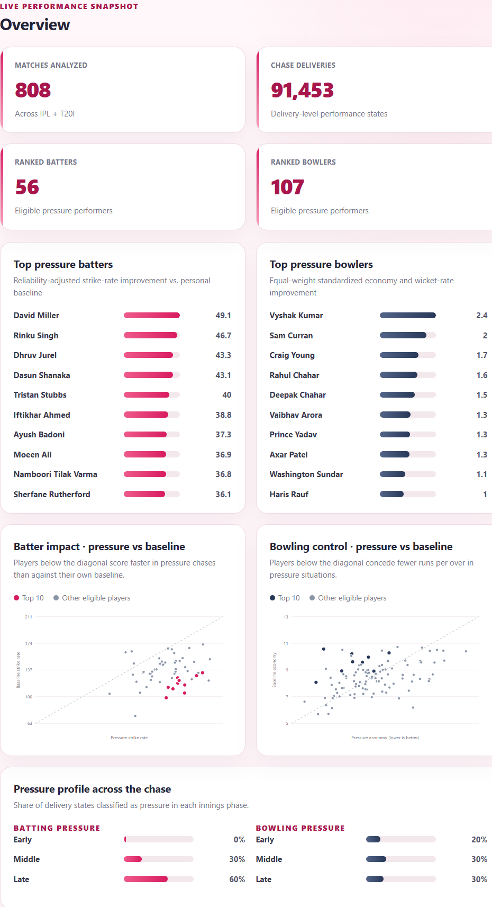
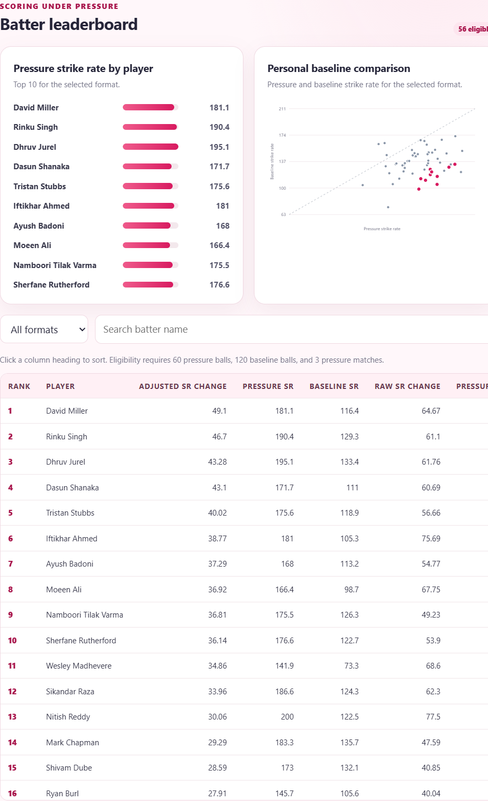
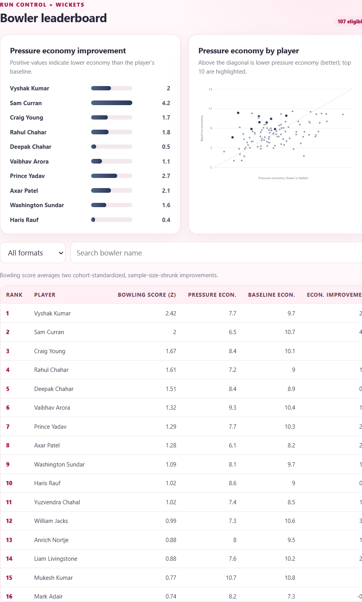
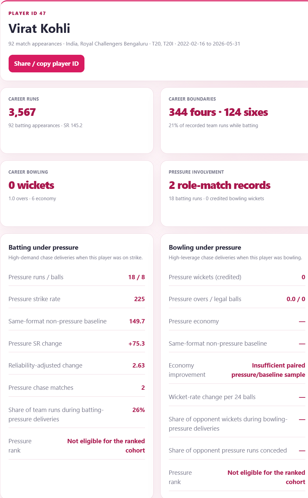

# SupeRR Selector Season 2

**A reproducible IPL and T20I pressure-performance analysis with an interactive player dashboard.**

## Live dashboard

The live dashboard is available at:

**https://jayanesh2494.github.io/SupeRR-Selection/**

The static dashboard has a Rajasthan Royals-inspired light-pink theme, format filters, overview and comparison charts, batter and bowler leaderboards, and searchable player profiles with career, season, pressure, team-contribution, and match-record statistics.

### Dashboard screenshots

**Overview**



**Batter leaderboard**



**Bowler leaderboard**



**Player profile**



## Competition results

| Rank | Batter | Rank | Bowler |
|---:|---|---:|---|
| 1 | David Miller | 1 | Vyshak Kumar |
| 2 | Rinku Singh | 2 | Sam Curran |
| 3 | Dhruv Jurel | 3 | Craig Young |
| 4 | Dasun Shanaka | 4 | Rahul Chahar |
| 5 | Tristan Stubbs | 5 | Deepak Chahar |
| 6 | Iftikhar Ahmed | 6 | Vaibhav Arora |
| 7 | Ayush Badoni | 7 | Prince Yadav |
| 8 | Moeen Ali | 8 | Axar Patel |
| 9 | Namboori Tilak Varma | 9 | Washington Sundar |
| 10 | Sherfane Rutherford | 10 | Haris Rauf |

The methodology, qualifications, player IDs, confidence intervals, and full tables are included in the local submission package under `reports/`. Generated reports and ranking CSVs are intentionally excluded from Git; see the reproduction steps below to regenerate them.

## Repository layout

```text
.
├── .github/workflows/       # Test and publish GitHub Pages
├── data/                    # Local-only source CSVs (not committed)
├── docs/                    # GitHub Pages site (index.html)
├── notebooks/               # Reproducible exploration and analysis notebooks
├── reports/                 # Local-only generated reports and rankings (gitignored)
├── src/                     # Data preparation, validation, analysis, dashboard code
├── tests/                   # Automated regression tests
├── docs/images/             # Dashboard screenshots
├── .gitignore
├── requirements.txt
└── README.md
```

## Data and privacy

The six supplied source CSVs are intentionally excluded from Git. Their redistribution rights have not been established, and they include a large ball-by-ball file. Put the files in the local `data/` directory to run the analysis. The deployed dashboard and generated reports contain derived player statistics and profiles; publishing this repository makes those outputs publicly viewable.

Generated submission documents, reports, and ranking CSVs in `reports/` are retained locally and ignored by Git. Screenshots in `docs/images/` are included in the repository so the README and submission package can show the live dashboard. The analysis does not alter source files. It reports incomplete mappings and data anomalies rather than silently inventing or correcting records.

## Reproduce locally

Requires Python 3.12 or a compatible Python version.

```powershell
python -m venv .venv
.\.venv\Scripts\Activate.ps1
python -m pip install -r requirements-dev.txt
```

Place the six source files in `data/` (or in the project root):

- `ball_by_ball.csv`
- `matches.csv`
- `competitions.csv`
- `teams.csv`
- `playing_eleven.csv`
- `competition_team_player_mapping.csv`

Run exploration, validation, analysis, and tests:

```powershell
python src/data_exploration.py
python src/data_validation.py
python src/pressure_analysis.py
python src/dashboard.py
python -m pytest -q
```

`python src/dashboard.py` regenerates the local analysis deliverables, `reports/dashboard.html`, and the deployable `docs/index.html`. The pre-generated `docs/index.html` is committed so GitHub Pages can publish without access to the private/local source CSVs.

## Method at a glance

- Analyzes eligible IPL (`IPL YYYY`) and T20I competitions from the supplied snapshot.
- Models live second-innings chases and computes match state before each delivery.
- Labels role-specific pressure using format-relative demand, wickets lost, and innings progress.
- Compares each player with their own non-pressure baseline within format.
- Applies pre-set sample eligibility and exposure shrinkage; rates bowlers on economy and credited-wicket improvement.
- Reports match consistency and bootstrap intervals for top-ten players.

Exact formulas, eligibility thresholds, diagnostics, and limitations are documented in the local submission package. The ranking is descriptive and dependent on the stated pressure definition; it is not a forecast or causal claim.

## Automated checks and deployment

GitHub Actions runs the test suite and deploys `docs/` to GitHub Pages when code is pushed to `main`. The Pages URL above hosts the dashboard; submission reports remain local and are not published as repository files.

## License and data rights

No license is granted for the supplied source datasets. Confirm rights before redistributing them. If adding a code license, choose one consistent with the competition rules and your ownership of the project.
