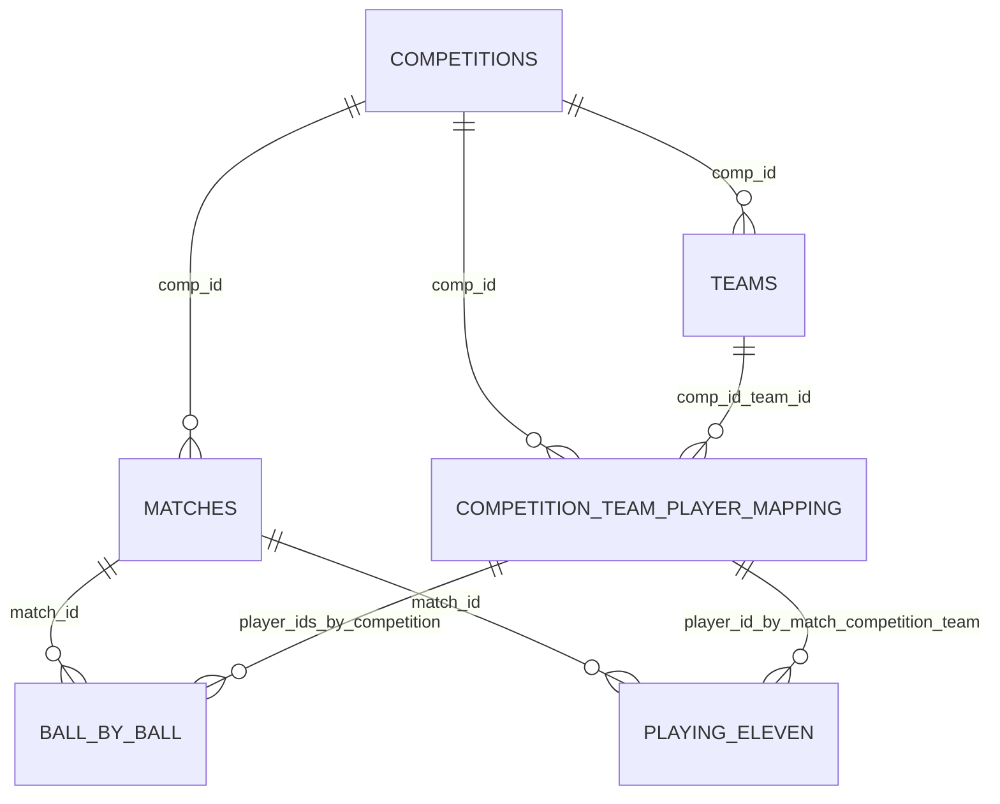

# SupeRR Selector Season 2 — Phase 1 Data Exploration and Validation

**Source directory:** `C:\Users\jayan\OneDrive\Desktop\RR`
**Datasets loaded:** 6
**Scope:** schema profiling, joins, and data-quality checks only. No source CSVs were modified; no player rankings or pressure labels were created.

## Dataset relationship diagram



The diagram shows candidate relationships, not enforced database constraints. `teams` is competition-scoped, so use `(comp_id, team_id)` rather than `team_id` alone. `playing_eleven` needs `matches` to obtain `comp_id` before checking its composite player mapping.

## Dataset profiles

### `ball_by_ball.csv`

- Shape: **200,999 rows × 33 columns**
- Exact duplicate records: **0**
- Individually unique, non-null columns: none
- Candidate primary keys tested: (`match_id`, `innings`, `overid`, `over_ball_num`) unique, (`match_id`, `innings`, `innings_ball_num`) unique
- Candidate foreign keys:
  - match_id -> matches.match_id
  - batting_team_id / bowling_team_id -> match home/away team IDs
  - striker_id / non_striker_id / bowler_id / dismissed_player_id -> competition_team_player_mapping by competition and player

| Column | Inferred dtype | Missing | Missing % | Distinct |
| --- | --- | --- | --- | --- |
| match_id | int64 | 0 | 0.00% | 867 |
| innings | int64 | 0 | 0.00% | 4 |
| overid | int64 | 0 | 0.00% | 20 |
| over_ball_num | int64 | 0 | 0.00% | 13 |
| innings_ball_num | int64 | 0 | 0.00% | 136 |
| batting_team_id | int64 | 0 | 0.00% | 38 |
| bowling_team_id | int64 | 0 | 0.00% | 38 |
| striker_id | int64 | 0 | 0.00% | 888 |
| striker_name | object | 0 | 0.00% | 885 |
| non_striker_id | int64 | 0 | 0.00% | 867 |
| non_striker_name | object | 0 | 0.00% | 864 |
| bowler_id | int64 | 0 | 0.00% | 647 |
| bowler_name | object | 0 | 0.00% | 646 |
| batting_type | object | 0 | 0.00% | 2 |
| bowling_type | object | 0 | 0.00% | 12 |
| batting_order | int64 | 0 | 0.00% | 13 |
| runs | int64 | 0 | 0.00% | 7 |
| is_four | bool | 0 | 0.00% | 2 |
| is_six | bool | 0 | 0.00% | 2 |
| is_wicket | bool | 0 | 0.00% | 2 |
| dismissal_type_id | float64 | 190118 | 94.59% | 8 |
| dismissal_type | object | 190118 | 94.59% | 9 |
| dismissed_player_id | float64 | 190107 | 94.58% | 814 |
| extras_type | object | 189167 | 94.11% | 6 |
| extras1_runs | int64 | 0 | 0.00% | 6 |
| extras_2_runs | int64 | 0 | 0.00% | 3 |
| pace_or_spin | object | 0 | 0.00% | 2 |
| bowl_speed | float64 | 0 | 0.00% | 1033 |
| stroke | object | 6158 | 3.06% | 30 |
| delivery_style | object | 391 | 0.19% | 34 |
| over_or_around | object | 407 | 0.20% | 2 |
| on_or_off | object | 0 | 0.00% | 2 |
| delivery_ist_time | object | 0 | 0.00% | 200826 |

Sample records (first three):

```json
[
  {
    "match_id": 13511,
    "innings": 1,
    "overid": 1,
    "over_ball_num": 1,
    "innings_ball_num": 1,
    "batting_team_id": 22,
    "bowling_team_id": 28,
    "striker_id": 1187,
    "striker_name": "Jason Roy",
    "non_striker_id": 6273,
    "non_striker_name": "Tom Banton",
    "bowler_id": 1772,
    "bowler_name": "Sheldon Cottrell",
    "batting_type": "RHB",
    "bowling_type": "Left-arm fast-medium",
    "batting_order": 1,
    "runs": 0,
    "is_four": false,
    "is_six": false,
    "is_wicket": false,
    "dismissal_type_id": NaN,
    "dismissal_type": NaN,
    "dismissed_player_id": NaN,
    "extras_type": NaN,
    "extras1_runs": 0,
    "extras_2_runs": 0,
    "pace_or_spin": "Pace",
    "bowl_speed": 0.0,
    "stroke": "Cover Drive",
    "delivery_style": "Inswing",
    "over_or_around": "Over",
    "on_or_off": "Off-side",
    "delivery_ist_time": "2022-01-23 00:00:00 UTC"
  },
  {
    "match_id": 13511,
    "innings": 1,
    "overid": 1,
    "over_ball_num": 2,
    "innings_ball_num": 2,
    "batting_team_id": 22,
    "bowling_team_id": 28,
    "striker_id": 1187,
    "striker_name": "Jason Roy",
    "non_striker_id": 6273,
    "non_striker_name": "Tom Banton",
    "bowler_id": 1772,
    "bowler_name": "Sheldon Cottrell",
    "batting_type": "RHB",
    "bowling_type": "Left-arm fast-medium",
    "batting_order": 1,
    "runs": 0,
    "is_four": false,
    "is_six": false,
    "is_wicket": false,
    "dismissal_type_id": NaN,
    "dismissal_type": NaN,
    "dismissed_player_id": NaN,
    "extras_type": NaN,
    "extras1_runs": 0,
    "extras_2_runs": 0,
    "pace_or_spin": "Pace",
    "bowl_speed": 0.0,
    "stroke": "Flick",
    "delivery_style": "Inswing",
    "over_or_around": "Over",
    "on_or_off": "On-side",
    "delivery_ist_time": "2022-01-23 00:00:00 UTC"
  },
  {
    "match_id": 13511,
    "innings": 1,
    "overid": 1,
    "over_ball_num": 3,
    "innings_ball_num": 3,
    "batting_team_id": 22,
    "bowling_team_id": 28,
    "striker_id": 1187,
    "striker_name": "Jason Roy",
    "non_striker_id": 6273,
    "non_striker_name": "Tom Banton",
    "bowler_id": 1772,
    "bowler_name": "Sheldon Cottrell",
    "batting_type": "RHB",
    "bowling_type": "Left-arm fast-medium",
    "batting_order": 1,
    "runs": 0,
    "is_four": false,
    "is_six": false,
    "is_wicket": false,
    "dismissal_type_id": NaN,
    "dismissal_type": NaN,
    "dismissed_player_id": NaN,
    "extras_type": NaN,
    "extras1_runs": 0,
    "extras_2_runs": 0,
    "pace_or_spin": "Pace",
    "bowl_speed": 0.0,
    "stroke": "Square Cut",
    "delivery_style": "Inswing",
    "over_or_around": "Over",
    "on_or_off": "Off-side",
    "delivery_ist_time": "2022-01-23 00:00:00 UTC"
  }
]
```

### `matches.csv`

- Shape: **883 rows × 22 columns**
- Exact duplicate records: **0**
- Individually unique, non-null columns: `match_id`
- Candidate primary keys tested: (`match_id`) unique
- Candidate foreign keys:
  - comp_id -> competitions.comp_id
  - home_team_id / away_team_id / toss_win_team_id / win_team_id -> teams by comp_id and team_id
  - home_team_captain_id / away_team_captain_id / man_of_the_match -> competition_team_player_mapping by comp_id and player_id

| Column | Inferred dtype | Missing | Missing % | Distinct |
| --- | --- | --- | --- | --- |
| match_id | int64 | 0 | 0.00% | 883 |
| comp_id | int64 | 0 | 0.00% | 138 |
| match_number | int64 | 0 | 0.00% | 75 |
| match_date | object | 0 | 0.00% | 686 |
| stage | object | 0 | 0.00% | 7 |
| venue_id | int64 | 0 | 0.00% | 98 |
| venue_country | object | 0 | 0.00% | 17 |
| home_team_id | int64 | 0 | 0.00% | 36 |
| home_team | object | 0 | 0.00% | 36 |
| away_team_id | int64 | 0 | 0.00% | 36 |
| away_team | object | 0 | 0.00% | 36 |
| home_team_captain_id | float64 | 44 | 4.98% | 89 |
| away_team_captain_id | float64 | 45 | 5.10% | 98 |
| toss_win_team_id | float64 | 15 | 1.70% | 37 |
| toss_opted | object | 15 | 1.70% | 2 |
| man_of_the_match | int64 | 0 | 0.00% | 293 |
| first_inn_revised_overs | float64 | 858 | 97.17% | 13 |
| second_inn_revised_overs | float64 | 858 | 97.17% | 12 |
| revised_target | float64 | 860 | 97.40% | 23 |
| knock_out | int64 | 0 | 0.00% | 2 |
| win_team_id | float64 | 41 | 4.64% | 36 |
| result | object | 0 | 0.00% | 670 |

Sample records (first three):

```json
[
  {
    "match_id": 13511,
    "comp_id": 1331,
    "match_number": 1,
    "match_date": "2022-01-22",
    "stage": "League",
    "venue_id": 54,
    "venue_country": "West Indies",
    "home_team_id": 28,
    "home_team": "West Indies",
    "away_team_id": 22,
    "away_team": "England",
    "home_team_captain_id": NaN,
    "away_team_captain_id": NaN,
    "toss_win_team_id": 28.0,
    "toss_opted": "Fielding",
    "man_of_the_match": 0,
    "first_inn_revised_overs": NaN,
    "second_inn_revised_overs": NaN,
    "revised_target": NaN,
    "knock_out": 0,
    "win_team_id": 28.0,
    "result": "West Indies Won by 9 Wickets"
  },
  {
    "match_id": 13512,
    "comp_id": 1331,
    "match_number": 2,
    "match_date": "2022-01-23",
    "stage": "League",
    "venue_id": 54,
    "venue_country": "West Indies",
    "home_team_id": 28,
    "home_team": "West Indies",
    "away_team_id": 22,
    "away_team": "England",
    "home_team_captain_id": 494.0,
    "away_team_captain_id": 478.0,
    "toss_win_team_id": 28.0,
    "toss_opted": "Fielding",
    "man_of_the_match": 0,
    "first_inn_revised_overs": NaN,
    "second_inn_revised_overs": NaN,
    "revised_target": NaN,
    "knock_out": 0,
    "win_team_id": 22.0,
    "result": "England Won by 1 Run"
  },
  {
    "match_id": 13513,
    "comp_id": 1331,
    "match_number": 3,
    "match_date": "2022-01-26",
    "stage": "League",
    "venue_id": 54,
    "venue_country": "West Indies",
    "home_team_id": 28,
    "home_team": "West Indies",
    "away_team_id": 22,
    "away_team": "England",
    "home_team_captain_id": 494.0,
    "away_team_captain_id": 1596.0,
    "toss_win_team_id": 22.0,
    "toss_opted": "Fielding",
    "man_of_the_match": 4986,
    "first_inn_revised_overs": NaN,
    "second_inn_revised_overs": NaN,
    "revised_target": NaN,
    "knock_out": 0,
    "win_team_id": 28.0,
    "result": "West Indies Won by 20 runs"
  }
]
```

### `competitions.csv`

- Shape: **141 rows × 4 columns**
- Exact duplicate records: **0**
- Individually unique, non-null columns: `comp_id`, `comp_name`
- Candidate primary keys tested: (`comp_id`) unique
- Candidate foreign keys:
  - None identified.

| Column | Inferred dtype | Missing | Missing % | Distinct |
| --- | --- | --- | --- | --- |
| comp_id | int64 | 0 | 0.00% | 141 |
| comp_name | object | 0 | 0.00% | 141 |
| match_format | object | 0 | 0.00% | 2 |
| season | object | 0 | 0.00% | 8 |

Sample records (first three):

```json
[
  {
    "comp_id": 3395,
    "comp_name": "South Africa in New Zealand T20I Series 2026",
    "match_format": "T20I",
    "season": "2026"
  },
  {
    "comp_id": 3405,
    "comp_name": "Afghanistan v Sri Lanka T20I Series 2026",
    "match_format": "T20I",
    "season": "2026"
  },
  {
    "comp_id": 3465,
    "comp_name": "India in Zimbabwe T20I Series 2026",
    "match_format": "T20I",
    "season": "2026"
  }
]
```

### `teams.csv`

- Shape: **353 rows × 3 columns**
- Exact duplicate records: **0**
- Individually unique, non-null columns: none
- Candidate primary keys tested: (`comp_id`, `team_id`) unique
- Candidate foreign keys:
  - comp_id -> competitions.comp_id
  - (comp_id, team_id) -> competition_team_player_mapping

| Column | Inferred dtype | Missing | Missing % | Distinct |
| --- | --- | --- | --- | --- |
| comp_id | int64 | 0 | 0.00% | 141 |
| team_id | int64 | 0 | 0.00% | 38 |
| team_name | object | 0 | 0.00% | 38 |

Sample records (first three):

```json
[
  {
    "comp_id": 1331,
    "team_id": 22,
    "team_name": "England"
  },
  {
    "comp_id": 1331,
    "team_id": 28,
    "team_name": "West Indies"
  },
  {
    "comp_id": 1335,
    "team_id": 18,
    "team_name": "India"
  }
]
```

### `playing_eleven.csv`

- Shape: **28,381 rows × 9 columns**
- Exact duplicate records: **0**
- Individually unique, non-null columns: none
- Candidate primary keys tested: (`match_id`, `team_id`, `player_id`) not unique
- Candidate foreign keys:
  - match_id -> matches.match_id
  - (match_id, team_id) -> match home/away team IDs
  - (match competition, team_id, player_id) -> competition_team_player_mapping

| Column | Inferred dtype | Missing | Missing % | Distinct |
| --- | --- | --- | --- | --- |
| match_id | int64 | 0 | 0.00% | 880 |
| team_id | int64 | 0 | 0.00% | 38 |
| player_id | int64 | 0 | 0.00% | 1082 |
| batting_order | float64 | 8678 | 30.58% | 13 |
| is_played | bool | 0 | 0.00% | 2 |
| is_captain | object | 8667 | 30.54% | 2 |
| is_wk | object | 8667 | 30.54% | 2 |
| is_impact | int64 | 0 | 0.00% | 2 |
| is_impact_off | int64 | 0 | 0.00% | 2 |

Sample records (first three):

```json
[
  {
    "match_id": 13511,
    "team_id": 22,
    "player_id": 1187,
    "batting_order": 1.0,
    "is_played": true,
    "is_captain": false,
    "is_wk": false,
    "is_impact": 0,
    "is_impact_off": 0
  },
  {
    "match_id": 13511,
    "team_id": 22,
    "player_id": 6273,
    "batting_order": 2.0,
    "is_played": true,
    "is_captain": false,
    "is_wk": false,
    "is_impact": 0,
    "is_impact_off": 0
  },
  {
    "match_id": 13511,
    "team_id": 22,
    "player_id": 1210,
    "batting_order": 3.0,
    "is_played": true,
    "is_captain": false,
    "is_wk": false,
    "is_impact": 0,
    "is_impact_off": 0
  }
]
```

### `competition_team_player_mapping.csv`

- Shape: **6,413 rows × 6 columns**
- Exact duplicate records: **0**
- Individually unique, non-null columns: none
- Candidate primary keys tested: (`comp_id`, `team_id`, `player_id`) unique
- Candidate foreign keys:
  - comp_id -> competitions.comp_id
  - (comp_id, team_id) -> teams

| Column | Inferred dtype | Missing | Missing % | Distinct |
| --- | --- | --- | --- | --- |
| comp_id | int64 | 0 | 0.00% | 140 |
| comp_name | object | 0 | 0.00% | 140 |
| team_id | int64 | 0 | 0.00% | 38 |
| team_name | object | 0 | 0.00% | 38 |
| player_id | int64 | 0 | 0.00% | 1217 |
| player_name | object | 0 | 0.00% | 1210 |

Sample records (first three):

```json
[
  {
    "comp_id": 1331,
    "comp_name": "England in West Indies T20I Series 2022",
    "team_id": 22,
    "team_name": "England",
    "player_id": 478,
    "player_name": "Eoin Morgan"
  },
  {
    "comp_id": 1331,
    "comp_name": "England in West Indies T20I Series 2022",
    "team_id": 22,
    "team_name": "England",
    "player_id": 479,
    "player_name": "Adil Rashid"
  },
  {
    "comp_id": 1331,
    "comp_name": "England in West Indies T20I Series 2022",
    "team_id": 22,
    "team_name": "England",
    "player_id": 722,
    "player_name": "Liam Dawson"
  }
]
```

## Relationship validation

| Join / consistency check | Unmatched distinct keys / source rows | Examples |
| --- | --- | --- |
| ball_by_ball.match_id -> matches.match_id | 0 / 0 | [] |
| matches.match_id with no ball-by-ball records | 16 / 16 | [[31281], [31284], [31288], [32610], [32612], [32622], [38797], [36564], [36210], [40761]] |
| matches.comp_id -> competitions.comp_id | 0 / 0 | [] |
| teams.comp_id -> competitions.comp_id | 0 / 0 | [] |
| mapping.comp_id -> competitions.comp_id | 0 / 0 | [] |
| mapping.(comp_id, team_id) -> teams | 0 / 0 | [] |
| teams.(comp_id, team_id) -> mapping | 5 / 5 | [[1537, 23], [1537, 27], [2940, 18], [2940, 21], [3405, 27]] |
| matches.home_team_id -> teams by competition | 0 / 0 | [] |
| matches.away_team_id -> teams by competition | 0 / 0 | [] |
| matches.home_team agrees with team ID | 0 / 0 | [] |
| matches.away_team agrees with team ID | 0 / 0 | [] |
| playing_eleven.match_id -> matches.match_id | 0 / 0 | [] |
| playing_eleven.team_id -> match home/away team | 0 / 0 | [] |
| playing_eleven player -> mapping by competition and team | 1 / 5 | [[2670, 4444, 29833]] |
| ball_by_ball.striker_id -> mapping by competition | 0 / 0 | [] |
| ball_by_ball.non_striker_id -> mapping by competition | 0 / 0 | [] |
| ball_by_ball.bowler_id -> mapping by competition | 0 / 0 | [] |
| ball_by_ball.dismissed_player_id -> mapping by competition | 0 / 0 | [] |
| matches.home_team_captain_id -> mapping by competition | 0 / 0 | [] |
| matches.away_team_captain_id -> mapping by competition | 0 / 0 | [] |
| matches.man_of_the_match -> mapping by competition | 0 / 0 | [] |
| matches.toss_win_team_id -> teams by competition | 0 / 0 | [] |
| matches.win_team_id -> teams by competition | 0 / 0 | [] |
| ball_by_ball batting/bowling teams are the match teams | 0 / 0 | [] |

An unmatched match with no ball-by-ball data is not automatically an error; its match result is shown in the cricket checks. The five `teams` competition/team pairs absent from the mapping table can reflect mapping coverage gaps; they are retained and reported.

## Cricket data validation

| Area | Observed results |
| --- | --- |
| Innings row counts | {"1": 105727, "2": 95234, "3": 25, "4": 13} |
| Matches missing innings 1 or 2 | {"count": 22, "examples": [15410, 15546, 20226, 21406, 28333, 31707, 35424, 37353, 39983, 39985]} |
| Rows / matches with innings > 2 | {"row_count": 38, "match_count": 6, "innings_values": [3, 4]} |
| Delivery numbering | {"candidate_key_duplicate_rows": 0, "innings_sequence_duplicate_rows": 0, "over_ball_num_min": 1, "over_ball_num_max": 13, "over_ball_num_above_6_rows": 8429, "over_ball_num_above_6_examples": [{"match_id": 13511, "innings": 1, "overid": 7, "over_ball_num": 7, "extras_type": NaN}, {"match_id": 13511, "innings": 1, "overid": 8, "over_ball_num": 7, "extras_type": NaN}, {"match_id": 13511, "innings": 1, "overid": 8, "over_ball_num": 8, "extras_type": NaN}, {"match_id": 13512, "innings": 1, "overid": 10, "over_ball_num": 7, "extras_type": NaN}, {"match_id": 13512, "innings": 1, "overid": 10, "over_ball_num": 8, "extras_type": NaN}, {"match_id": 13512, "innings": 1, "overid": 12, "over_ball_num": 7, "extras_type": NaN}, {"match_id": 13512, "innings": 1, "overid": 14, "over_ball_num": 7, "extras_type": NaN}, {"match_id": 13512, "innings": 1, "overid": 16, "over_ball_num": 7, "extras_type": NaN}, {"match_id": 13512, "innings": 1, "overid": 17, "over_ball_num": 7, "extras_type": NaN}, {"match_id": 13512, "innings": 1, "overid": 18, "over_ball_num": 7, "extras_type": NaN}], "overid_min": 1, "overid_max": 20} |
| Extras checks | {"types": {"nan": 189167, "wide": 7714, "legbyes": 2748, "Overstep": 576, "byes": 529, "other": 264, "Penalty": 1}, "nonzero_runs_without_type_rows": 2, "nonzero_runs_without_type_examples": [{"match_id": 17555, "innings": 1, "overid": 5, "over_ball_num": 4, "extras1_runs": 0, "extras_2_runs": 1}, {"match_id": 36097, "innings": 2, "overid": 8, "over_ball_num": 6, "extras1_runs": 1, "extras_2_runs": 0}], "type_present_but_numeric_fields_zero_rows": 1, "type_present_but_numeric_fields_zero_examples": [{"match_id": 37099, "innings": 1, "overid": 14, "over_ball_num": 1, "extras_type": "legbyes", "extras1_runs": 0, "extras_2_runs": 0}], "negative_extras_rows": 0} |
| Wicket checks | {"wicket_rows": 10881, "wicket_without_dismissal_type_id": 0, "dismissal_type_id_without_wicket_flag": 0, "wicket_without_dismissed_player_id": 1, "dismissed_player_id_without_wicket_flag": 12, "dismissed_player_id_without_wicket_examples": [{"match_id": 14114, "innings": 2, "overid": 14, "over_ball_num": 1, "dismissed_player_id": 1440.0}, {"match_id": 15610, "innings": 1, "overid": 6, "over_ball_num": 6, "dismissed_player_id": 6433.0}, {"match_id": 16064, "innings": 2, "overid": 2, "over_ball_num": 4, "dismissed_player_id": 126.0}, {"match_id": 20188, "innings": 1, "overid": 11, "over_ball_num": 1, "dismissed_player_id": 2003.0}, {"match_id": 20243, "innings": 1, "overid": 16, "over_ball_num": 6, "dismissed_player_id": 4219.0}, {"match_id": 20880, "innings": 2, "overid": 11, "over_ball_num": 3, "dismissed_player_id": 2533.0}, {"match_id": 28964, "innings": 1, "overid": 10, "over_ball_num": 6, "dismissed_player_id": 1568.0}, {"match_id": 29926, "innings": 2, "overid": 9, "over_ball_num": 4, "dismissed_player_id": 6931.0}, {"match_id": 31709, "innings": 1, "overid": 13, "over_ball_num": 3, "dismissed_player_id": 3024.0}, {"match_id": 37094, "innings": 2, "overid": 6, "over_ball_num": 7, "dismissed_player_id": 4780.0}], "wicket_without_dismissed_player_examples": [{"match_id": 40709, "innings": 2, "overid": 19, "over_ball_num": 5, "dismissal_type": "Retire Out"}]} |
| Boundary flag checks | {"four_and_six_both_true": 0, "is_four_but_runs_not_4": 0, "is_six_but_runs_not_6": 0} |
| Batter/bowler name checks | {"striker_name": {"mismatch_count": 1, "examples": [{"comp_id": 3128, "player_id": 4458, "observed_name": "Aneurin Donald", "mapped_name": "AHT Donald"}]}, "non_striker_name": {"mismatch_count": 1, "examples": [{"comp_id": 3128, "player_id": 4458, "observed_name": "Aneurin Donald", "mapped_name": "AHT Donald"}]}, "bowler_name": {"mismatch_count": 0, "examples": []}} |
| Matches without ball data | {"count": 16, "result_counts": {"Match Abandoned": 16}, "examples": [{"match_id": 31281, "result": "Match Abandoned"}, {"match_id": 31284, "result": "Match Abandoned"}, {"match_id": 31288, "result": "Match Abandoned"}, {"match_id": 32610, "result": "Match Abandoned"}, {"match_id": 32612, "result": "Match Abandoned"}, {"match_id": 32622, "result": "Match Abandoned"}, {"match_id": 38797, "result": "Match Abandoned"}, {"match_id": 36564, "result": "Match Abandoned"}, {"match_id": 36210, "result": "Match Abandoned"}, {"match_id": 40761, "result": "Match Abandoned"}]} |
| Competition formats and seasons | {"competition_counts": {"T20I": 134, "T20": 7}, "match_counts": {"T20I": 482, "T20": 401}, "seasons": ["2022", "2022/23", "2023", "2023/24", "2024", "2024/25", "2025", "2026"]} |

### Interpretation notes

- `over_ball_num` exceeds 6 in some rows. The field’s exact numbering semantics are not documented in these files, so these rows are flagged for source clarification rather than dropped or automatically treated as invalid.
- Innings numbered 3 or 4 may represent super overs or other extra innings; that interpretation is plausible but cannot be proven from these columns alone.
- `runs`, `extras1_runs`, and `extras_2_runs` are reported as distinct observed fields. The implementation does not assume that `runs` is the total including extras.
- A zero `man_of_the_match` value is treated as a sentinel and excluded from player foreign-key checks; that interpretation should be confirmed with the data provider.
- No records are deleted or rewritten. Missingness and anomalous records remain visible in the report.

## Assumptions and limitations

- Candidate keys and relationships are validated by observed IDs and uniqueness; CSVs do not declare database constraints.
- Candidate player mapping is scoped to the competition. Batter, bowler, dismissal, captain, and player-of-the-match IDs are checked against the available mapping table.
- `data/` is preferred when it contains all six inputs. For this workspace, the six CSVs were found at the workspace root and the scripts use that location as a fallback.
- The reported dtypes are pandas inference from the input CSVs, not an authoritative source schema.
- Phase 1 does not calculate player rankings or classify pressure situations.
